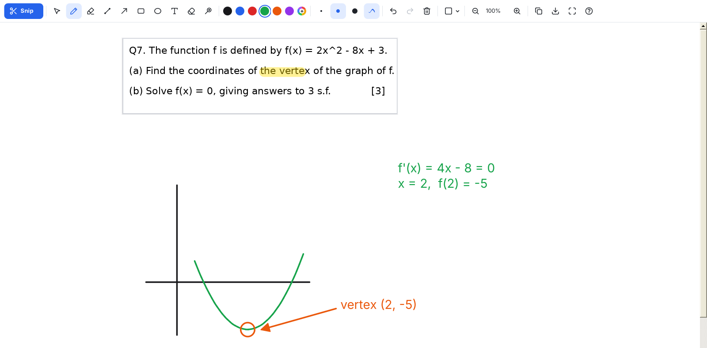

<h1 align="center">Math Snip Board</h1>

<b>Snip any part of the screen and teach on it.</b> 
A pen-tablet whiteboard for math lessons on Windows: one small exe, no install.

<a href="https://github.com/ZInuke21/math-snip-board/releases/latest/download/MathSnipBoard.exe"><b>Download MathSnipBoard.exe</b></a>

## What it does

- **Snip** – press `Ctrl + Alt + S` anywhere, drag a box around a question, and it opens on a board with space around it. Snip again to add the next question below.
- **Write like on paper** – smooth pen-tablet ink with pressure, palm-free Windows Ink input, and a real eraser (flip the pen).
- **Perfect shapes** – draw a line or circle and keep the pen still for a moment and it snaps perfectly straight or round. Line, arrow, rectangle and circle tools too (hold Shift for 45° / squares / circles).
- **Teach** – highlighter, text, laser pointer, graph paper / lines / dots, zoom, full screen.
- **Move the question** – drag or resize a snip and the working written on it comes along.
- **Share** – copy the board, or save it as PNG, JPG or PDF.
- **Stays up to date** – checks this repo for new releases and updates itself in one click.

Works on Windows 10 and 11 (uses the .NET Framework that comes with Windows). The first time, Windows SmartScreen may say *"Windows protected your PC"* → **More info → Run anyway**.

## Shortcuts

| Keys | Action |
|---|---|
| `Ctrl + Alt + S` | New snip from anywhere |
| `Ctrl + N` | Snip onto the current board |
| `P` `H` `L` `A` `R` `O` | Pen, highlighter, line, arrow, rectangle, circle |
| `T` `E` `K` `V` | Text, eraser, laser pointer, select |
| `1` `2` `3` | Thin, medium, thick |
| `Space` + drag | Scroll around the board |
| `Ctrl` + scroll | Zoom |
| `Ctrl + Z` / `Ctrl + Y` | Undo / redo |
| `Ctrl + C` / `Ctrl + S` / `Ctrl + V` | Copy / save / paste a picture |
| `G` | Change page background |
| `F11` | Full screen |

## Releasing an update

Every running copy checks [Releases](https://github.com/ZInuke21/math-snip-board/releases) every few hours and shows an **Update** button when there's something new.

1. Make the change and push it to `main`.
2. Go to **Actions → [Build & release](../../actions/workflows/release.yml) → Run workflow**, type the new version (e.g. `2.2.0`) and what's new (e.g. `Fixed eraser lag; Added purple`), and click **Run workflow**.
3. GitHub compiles the exe on Windows, runs the self-test, and publishes the release. The teacher's app offers the update on its own.

(Prefer git? `git tag -a v2.2.0 -m "* Fixed eraser lag"` and `git push origin v2.2.0` does the same.)

## Building it yourself

- **Windows:** run `build.cmd` (uses the C# compiler built into Windows, nothing to install).
- **Linux / macOS:** `./build.sh` with [Mono](https://www.mono-project.com/) installed.
- `MathSnipBoard.exe --selftest <folder>` runs the built-in checks.

---

Made by Mohaneesh Uppara.
